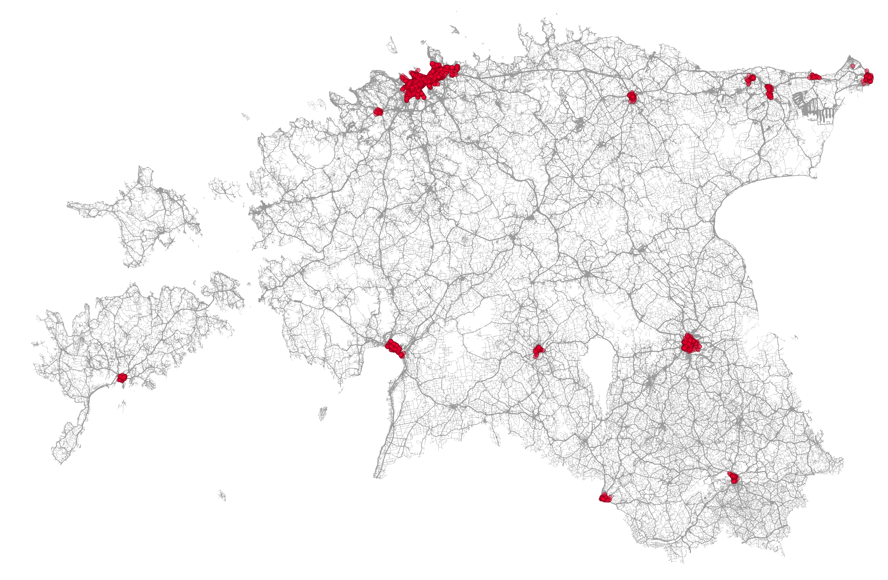
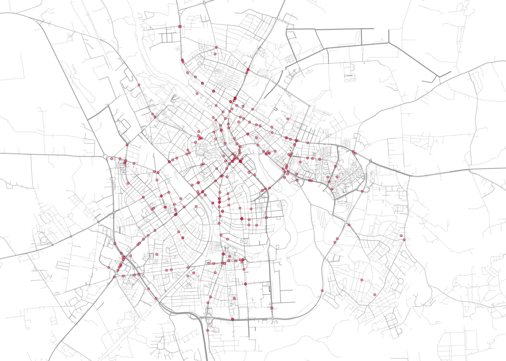
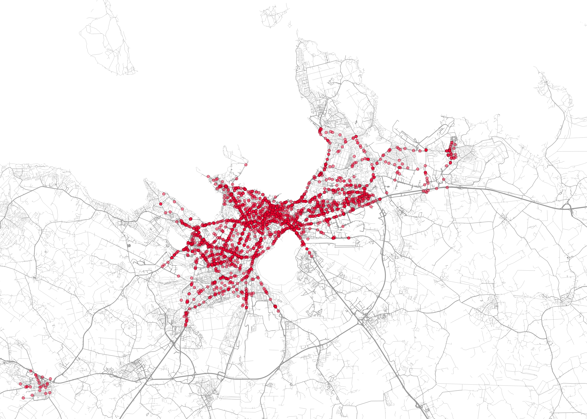

# PyQGIS Road Width and Accident Maps

Can the road width and accident maps from the SQL analysis be rebuilt as repeatable code, instead of manual work in QGIS?

---

## Terms

| Term | Meaning |
|---|---|
| PyQGIS | The Python interface of QGIS, used here to load, style and export maps with code |
| WFS | Web Feature Service, a web service that delivers map data (here: the road width layer) |
| GeoPackage | A single-file format for spatial data (`roads.gpkg`) |
| EPSG:3301 | Estonian Coordinate System of 1997, the coordinate system of all data in this project |
| Graduated renderer | A QGIS style that picks the symbol (here: line thickness) from the value of a field (here: road width) |
| Extent | The rectangle of the map that is drawn, given as west, south, east and north edges |

---

## What this is

Python scripts that build maps of casualty accidents and road width in urban Estonia, 2018-2025. The scripts load the data from files, style the layers and export PNG maps for Estonia, Tartu and Tallinn.

The data was cleaned and analysed in SQL in a separate project: [road-width-influence-on-accident-severity](https://github.com/AleDorosh/road-width-influence-on-accident-severity). This project covers the mapping part only.

---

## Maps



### Zoomed in

| Tartu | Tallinn |
|---|---|
|  |  |

Roads are grey lines, thicker for wider roads. Accidents are semi-transparent red points, so dense areas look darker.

---

## Data

#### Road width data

* Dataset: TN.RoadTransportNetwork.RoadWidth
* Provider: Eesti topograafia andmekogu, Maa- ja Ruumiamet (Estonian Land and Spatial Development Board)
* Service endpoint (WFS): https://inspire.geoportaal.ee/geoserver/TN_transportetak/wfs
* Licence: CC BY 4.0
* Not stored in this repository (large file). `download_roads.py` creates `data/roads.gpkg`.

#### Traffic accident data

* Dataset: Inimkannatanutega liiklusõnnetuste andmed (Traffic accidents with casualties)
* Provider: Eesti Transpordiamet, via the Estonian Open Data Portal
* Dataset page: https://andmed.eesti.ee/datasets/inimkannatanutega-liiklusonnetuste-andmed
* Licence: CC BY 3.0
* `data/accidents_cleaned.csv` is the cleaned and joined version from the SQL project: 3,533 accidents with road width already attached.

---

## How it works

| Step | Script | What it does |
|---|---|---|
| 1 | `download_roads.py` | Downloads all roads from the WFS service once and saves them to `data/roads.gpkg` |
| 2 | `build_map.py` | Loads the accident CSV and the roads, styles both and exports one PNG per area |

Styling decisions:

* Road width classes are the same as in the SQL analysis and the Tableau chart: up to 5 m, 6-8 m, 9-11 m, 12-14 m and 15+ m. The upper limit is inclusive.
* Line thickness grows with road width, from 0.07 mm to 0.5 mm. All roads are grey, so the accident points stand out.
* Points are small and semi-transparent. Overlapping accidents show as darker areas.
* Maps are exported at 300 dpi. The two city maps use the same shape.

---

## Check against the SQL results

Before building the maps, the fatality rate per road width class was calculated again in PyQGIS (`learning_steps/01_check_fatality_rates.py`). The results match the SQL analysis.

| Road width | Accidents | Fatal accidents | Fatality rate |
|---|---|---|---|
| ≤5 m | 590 | 14 | 2.37% |
| 6-8 m | 1,257 | 16 | 1.27% |
| 9-11 m | 873 | 21 | 2.41% |
| 12-14 m | 364 | 8 | 2.20% |
| 15+ m | 449 | 5 | 1.11% |
| Total | 3,533 | 64 | 1.81% |

---

## Problems and fixes

| Problem | Fix |
|---|---|
| The WFS road layer is slow, and a render can start before all roads are downloaded | Saved the roads once to a GeoPackage and loaded them from the file |
| QGIS runs editor scripts from a temporary copy, so a script cannot find its own folder | `BASE_DIR` is set by hand at the top of each script |

---

## Running it

1. Install QGIS (tested with 3.44.7 on Ubuntu 24.04).
2. Clone the repository:

```
git clone https://github.com/AleDorosh/pyqgis-road-width-accident-maps.git
```

3. In QGIS, open Plugins > Python Console > Show Editor and open `download_roads.py`. Set `BASE_DIR` to the cloned folder and run it. The download takes several minutes.
4. Open `build_map.py`, set `BASE_DIR` and the map areas in `AREAS` (west, south, east, north in EPSG:3301), and run it.
5. The maps are saved in `images/`.

---

## Limitations

* The exported maps contain the map only. Title, legend and credits are not built in code yet.
* Map areas are set by hand as coordinates.
* Tested on one setup only (Ubuntu 24.04, QGIS 3.44.7).
* The road download depends on the WFS service being available and takes several minutes.
* The accident data is already cleaned and joined. The cleaning and the spatial join are in the SQL project and are not repeated here.

---

## Stack

* Python (PyQGIS), run in the QGIS script editor
* QGIS 3.44
* GeoPackage and WFS for the road data

---

## Repository structure

```
pyqgis-road-width-accident-maps/
├── README.md
├── build_map.py
├── download_roads.py
├── data/
│   └── accidents_cleaned.csv
├── images/
│   ├── map_estonia.png
│   ├── map_tartu.png
│   └── map_tallinn.png
├── learning_steps/
│   ├── 01_check_fatality_rates.py
│   ├── 02_style_roads.py
│   ├── 03_style_points.py
│   ├── 04_export_maps.py
│   └── 05_save_roads_to_gpkg.py
└── .gitignore
```

`data/roads.gpkg` is created by `download_roads.py` and is excluded in `.gitignore`.

---

## Author

Aleksandra Doroshenko

---

## Acknowledgement

AI tools were used during development to introduce PyQGIS, suggest code, explain errors and improve documentation. The scripts were run, tested and adapted by the author, and the results were checked against the SQL analysis.
